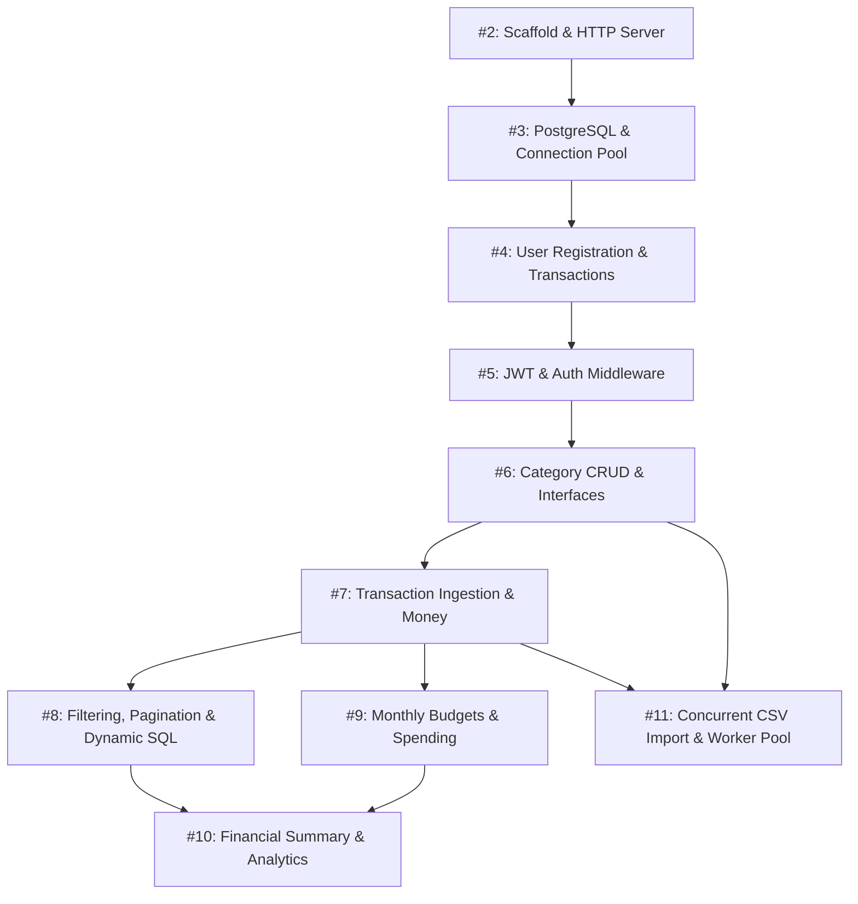

# FinTrack Go Learning Path — Cẩm Nang Lập Trình Go Backend Toàn Diện

Chào mừng bạn đến với lộ trình học tập Go Backend thực chiến dựa trên mã nguồn thực tế của dự án **FinTrack** (Hệ thống Quản lý Tài chính Cá nhân).

Toàn bộ tài liệu trong thư mục này được biên soạn dành cho lập trình viên bắt đầu học Go từ con số 0 (nhưng đã có nền tảng web TypeScript/JavaScript), giải thích cặn kẽ từ bản chất ngôn ngữ, triết lý thiết kế (Idiomatic Go), kỹ thuật xử lý cơ sở dữ liệu với `database/sql`, kiến trúc phân tầng (Clean Architecture), cho đến lập trình đa luồng (Concurrency với Goroutines & Channels).

---

## Mục Đích Của Bộ Tài Liệu (Purpose)

1. **Hiểu bản chất thay vì học vẹt**: Không chỉ dừng lại ở cú pháp `func`, `struct`, mà đi sâu vào mô hình bộ nhớ (Stack vs Heap, Pointer), cơ chế xử lý lỗi tường minh, và quản lý luồng.
2. **Học qua mã nguồn thực tế (Production-Ready Codebase)**: Toàn bộ ví dụ, phân tích file và luồng thực thi đều lấy trực tiếp từ dự án FinTrack, không dùng ví dụ đồ chơi (Toy examples).
3. **Chuẩn bị phỏng vấn Fresher/Junior Go Backend**: Mỗi bài học đi kèm bộ câu hỏi phỏng vấn song ngữ Anh - Việt có câu trả lời mẫu chuẩn mực và câu hỏi đào sâu.
4. **Làm chủ Concurrency**: Hiểu cặn kẽ Worker Pool, Channel ownership, Context cancellation và Data Race thông qua bài toán Import CSV hàng loạt.

---

## Bảng Lộ Trình Học Tập (Learning Roadmap)

Dưới đây là 10 bài học tương ứng với 10 Issue đã hoàn thành trong dự án:

| Bài học | Issue | Chủ đề chính | Các khái niệm Go & Backend cốt lõi |
| :--- | :--- | :--- | :--- |
| [Bài 02](./issue-02.md) | **#2** | Scaffold, Typed Config, HTTP Server & Graceful Shutdown | Packages, Modules (`go.mod`), Pointers, Defer, Context, OS Signals, Gin Engine, Graceful Shutdown, Functional Options |
| [Bài 03](./issue-03.md) | **#3** | PostgreSQL, Connection Pooling & Database Migrations | `database/sql`, Driver registration, Connection Pool tuning, `PingContext`, DDL Migrations, Idempotency, Docker |
| [Bài 04](./issue-04.md) | **#4** | User Registration, Password Hashing & Transactions | Password hashing (`bcrypt`), Validation, Database Transactions (`BeginTx`, `Commit`, `Rollback`), Atomicity, Domain Errors |
| [Bài 05](./issue-05.md) | **#5** | JWT Authentication, Middleware & Context Propagation | Stateless Auth, JWT Claims, HS256, Custom Gin Middleware, `c.Set` / `c.Get`, Context propagation, Bearer Token |
| [Bài 06](./issue-06.md) | **#6** | Category Management CRUD, Interfaces & Ownership | Go Interfaces, Dependency Injection, Multi-tenancy / User Scoping, PostgreSQL Unique Violation (23505), `ExecContext` |
| [Bài 07](./issue-07.md) | **#7** | Transaction CRUD, Money Representation & Nullable Fields | VND as `int64`/`BIGINT`, Calendar Date (`YYYY-MM-DD`), Pointers for Nullable Data, `ON DELETE SET NULL`, Foreign Keys |
| [Bài 08](./issue-08.md) | **#8** | Transaction Listing, Dynamic SQL & Offset Pagination | Dynamic SQL construction, Parameter placeholders (`$1, $2`), `LIMIT/OFFSET`, Deterministic Sorting, `COUNT(*)`, Query Strings |
| [Bài 09](./issue-09.md) | **#9** | Monthly Budgets, Upsert Pattern & Dynamic Spending | `ON CONFLICT DO UPDATE` (Upsert), `ON DELETE CASCADE`, Dynamic Spending JOIN, Date boundaries, `COALESCE` |
| [Bài 10](./issue-10.md) | **#10** | Financial Summary, Aggregation & Expense Analytics | SQL Aggregate (`SUM`, `CASE WHEN`, `GROUP BY`), Row Multiplication / Double Counting trap, Percentage Math, Trend Continuous Months |
| [Bài 11](./issue-11.md) | **#11** | Concurrent CSV Import, Worker Pool & Cancellation | Goroutines, Channels (Buffered/Unbuffered), Select, `sync.WaitGroup`, Producer-Consumer, 4-Worker Pool, Context Cancellation, Race Detector |

---

## Thứ Tự Học Tập Khuyến Nghị (Recommended Learning Order)

Các bài học được sắp xếp theo đúng tiến trình phát triển phần mềm chuẩn mực, bài sau kế thừa trực tiếp kiến trúc của bài trước:



- **Bước 1 (Nền tảng khởi động - Issue #2 & #3)**: Học cách khởi chạy HTTP server, nạp cấu hình, cấu hình connection pool cho PostgreSQL và chạy migration schema.
- **Bước 2 (Bảo mật & Người dùng - Issue #4 & #5)**: Nắm vững quy trình xác thực (Authentication), băm mật khẩu an toàn, cấp phát và xác minh JWT token qua Middleware.
- **Bước 3 (Nghiệp vụ cốt lõi - Issue #6 & #7)**: Làm chủ interface trong Go, cơ chế phân quyền theo User ID (Tenant Scoping), kỹ thuật lưu trữ tiền tệ bằng số nguyên `int64` và xử lý trường có thể `NULL`.
- **Bước 4 (Truy vấn nâng cao & Báo cáo - Issue #8, #9 & #10)**: Viết câu lệnh SQL động an toàn không bị SQL Injection, gom nhóm dữ liệu theo tháng, phòng tránh bẫy nhân đôi hàng (Row Multiplication) khi JOIN.
- **Bước 5 (Lập trình đa luồng đỉnh cao - Issue #11)**: Xây dựng hệ thống Import CSV chịu tải cao sử dụng mô hình Producer-Consumer và Worker Pool 4 luồng an toàn tuyệt đối với context cancellation.

---

## Bản Đồ Tri Thức Go Backend Toàn Diện (Final Knowledge Map)

```text
FinTrack Go Backend Knowledge Map
│
├── 1. Go Core & Memory Model
│   ├── Packages & Modules (go.mod, exported vs unexported capitalization)
│   ├── Structs & Zero Values (không có undefined, khởi tạo struct)
│   ├── Pointers (*, &, passing by reference vs value, Heap vs Stack)
│   ├── Methods & Receivers (Pointer Receiver vs Value Receiver)
│   ├── Interfaces (Implicit implementation, small interfaces, mocking)
│   ├── Error Handling (Errors are values, explicit if err != nil, %w wrapping)
│   ├── Slices & Maps (Header structure, append growth, make allocation)
│   └── Control Flow (defer LIFO cleanup, switch, select)
│
├── 2. Go HTTP Backend & Web Framework (Gin)
│   ├── HTTP Server Lifecycle (http.Server, ListenAndServe, Listen on TCP)
│   ├── Graceful Shutdown (os.Interrupt, syscall.SIGTERM, signal.NotifyContext)
│   ├── Routing & Route Groups (v1.Group, URL params, Query strings)
│   ├── Middleware Pattern (AuthMiddleware, Recovery, Logger, c.Next, c.Abort)
│   ├── Context Propagation (c.Request.Context, passing down layers)
│   ├── Request Parsing (ShouldBindJSON, FormFile, MaxBytesReader)
│   └── Standardized JSON Responses (Success envelopes, RFC-like Error objects)
│
├── 3. Database Layer (PostgreSQL & database/sql)
│   ├── Connection Pooling (MaxOpenConns, MaxIdleConns, ConnMaxLifetime)
│   ├── Query Execution (QueryContext, QueryRowContext, ExecContext)
│   ├── Result Mapping (rows.Scan, rows.Next, rows.Err, rows.Close)
│   ├── Transactions (BeginTx, Commit, defer Rollback)
│   ├── Prepared Statements (PrepareContext, batch insertion)
│   ├── SQL Aggregate Functions (SUM, COUNT, CASE WHEN, GROUP BY)
│   ├── JOIN & Constraints (LEFT JOIN, ON CONFLICT Upsert, ON DELETE CASCADE/SET NULL)
│   └── Database Migrations (golang-migrate, up/down DDL, idempotent scripts)
│
├── 4. Concurrency & Asynchronous Processing
│   ├── Goroutines (Lightweight green threads, 2KB initial stack)
│   ├── Channels (Buffered vs Unbuffered, Send `ch <-`, Receive `<-ch`)
│   ├── Channel Lifecycle (Producer closes channel, Coordinator pattern, range over channel)
│   ├── Synchronization (sync.WaitGroup, Add, Done, Wait)
│   ├── Multiplexing (select block, default case, timer timeouts)
│   ├── Context Cancellation (ctx.Done(), propagating cancel across workers)
│   ├── Worker Pool Pattern (Fixed number of workers processing job queues)
│   └── Concurrency Safety (Data Race detection via `go test -race`, mutex locks)
│
├── 5. Architecture & Clean Code
│   ├── Standard Go Project Layout (cmd/ for entry points, internal/ for private packages)
│   ├── 3-Tier Layered Architecture (Handler -> Service -> Repository)
│   ├── Single Responsibility & Separation of Concerns
│   ├── Dependency Injection (Passing interfaces into constructors)
│   ├── Functional Options Pattern (WithDB, WithJWTManager, etc.)
│   └── Domain Modeling (Clean entities without database/HTTP tags pollution)
│
├── 6. Security & Multi-Tenancy
│   ├── Password Security (bcrypt adaptive work factor hashing)
│   ├── JWT (Stateless tokens, HMAC-SHA256 signature, claim validation)
│   ├── Tenant Scoping (Strict WHERE user_id = $1 enforcement)
│   └── Payload Restrictions (HTTP MaxBytesReader payload protection)
│
└── 7. Testing & Quality Assurance
    ├── Standard Testing Framework (testing.T, t.Run, t.Fatalf, t.Errorf)
    ├── Unit Testing with In-Memory Fakes (No external DB dependencies)
    ├── HTTP Handler Testing (net/http/httptest, ResponseRecorder)
    ├── PostgreSQL Integration Testing (Real database, schema seeding, isolation check)
    └── Table-Driven Tests (Idiomatic test slices with subtests)
```

---

Bây giờ, hãy mở tài liệu **[Bài học Issue #02](./issue-02.md)** để bắt đầu hành trình chinh phục Go Backend!
