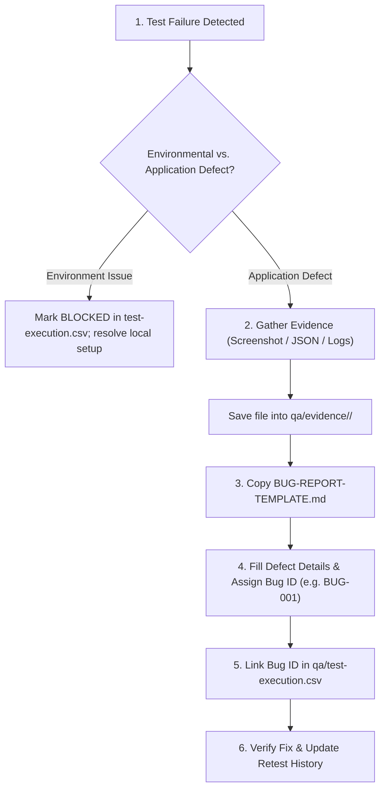
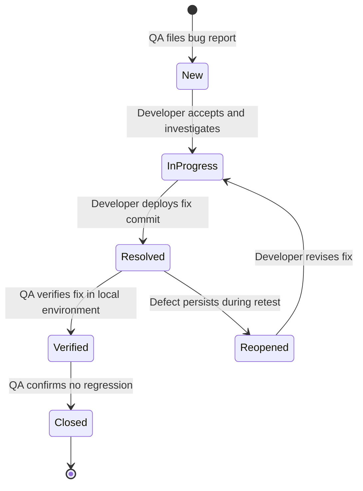

# Defect Tracking & Bug Reports Guide

This directory contains defect reports discovered during the testing activities of the FinTrack project, along with the standardized defect report template.

---

## 1. Directory Purpose

The `qa/bug-reports/` directory serves as the centralized repository for all defect documentation in FinTrack. Every confirmed defect must be recorded as a Markdown document using the standard template to ensure reproducibility, clear triage attributes, and seamless communication between QA and developers.

---

## 2. Directory Contents

- [BUG-REPORT-TEMPLATE.md](file:///d:/Go/pet-projects/fin-track/qa/bug-reports/BUG-REPORT-TEMPLATE.md): The standardized template for creating new defect reports.
- `BUG-XXX-<descriptive-slug>.md`: Individual bug report files created when a test case fails or an unexpected application defect is confirmed.

> [!NOTE]
> In Test Run **`TR-001`**, all **45** executed test cases completed successfully with a **PASS** status. Consequently, zero defect reports were filed for this baseline run. If future testing cycles (such as Phase 2 covering Budgets or Analytics) identify defects, new reports will be logged here following the process below.

---

## 3. Defect Reporting Workflow

When actual application behavior deviates from the documented `Expected Result`:



### Step 1: Distinguish Environment Issues from Application Defects
Before filing a bug report, confirm whether the issue stems from the environment or the application code:
- **Environment issue**: PostgreSQL container stopped, port conflict, missing `.env` configuration. -> Mark test as `BLOCKED`, fix local setup, and re-execute. Do **not** create a bug report.
- **Application defect**: Incorrect HTTP status codes, validation bypassed (e.g., negative amounts accepted), data leakage across users, or unhandled server crashes (`HTTP 500`). -> File a bug report.

### Step 2: Capture Evidence
Capture the exact request and response payload, Postman runner log, or UI screenshot. Store the artifact in the appropriate subdirectory under [qa/evidence/](file:///d:/Go/pet-projects/fin-track/qa/evidence/).

### Step 3: Create the Bug Report
Copy [BUG-REPORT-TEMPLATE.md](file:///d:/Go/pet-projects/fin-track/qa/bug-reports/BUG-REPORT-TEMPLATE.md) to a new file named according to the naming convention below:
```text
qa/bug-reports/BUG-001-type-mismatch-creates-transaction.md
```

### Step 4: Link to Execution Records
In [qa/test-execution.csv](file:///d:/Go/pet-projects/fin-track/qa/test-execution.csv), update the corresponding row:
- Set `Status` to `FAIL`.
- Set `Bug ID` to the assigned identifier (e.g., `BUG-001`).
- Set `Evidence Path` to the relative evidence file path.

---

## 4. File Naming Convention

All bug report files must adhere to the following convention:

$$\text{BUG-[XXX]-[concise-kebab-case-slug].md}$$

- `[XXX]`: Sequential 3-digit integer identifier (e.g., `BUG-001`, `BUG-002`).
- `[concise-kebab-case-slug]`: Short summary of the defect in lowercase hyphen-separated English (e.g., `idor-transaction-access-unauthorized`).

---

## 5. Severity & Priority Classification

Every bug report must be categorized with both **Severity** (impact on the system) and **Priority** (urgency of the fix):

| Level | Severity (Technical & Business Impact) | Priority (Resolution Urgency) |
| :--- | :--- | :--- |
| **Critical / High** | Cross-tenant data exposure (IDOR), unhandled server panic (`HTTP 500`), financial calculation error, or total blocker of core flows. | Resolve immediately; release hotfix before any next milestone. |
| **Major / High** | Core feature broken without workaround (e.g., valid registration fails, CSV import crashes worker pool). | Resolve in current sprint cycle. |
| **Medium / Medium** | Boundary validation missing, edge-case format errors, misleading error messages with working workaround. | Schedule in regular backlog. |
| **Minor / Low** | Cosmetic UI misalignment, typographical error, suboptimal currency or date label formatting. | Address during non-critical refinement. |

---

## 6. Defect Lifecycle



When a fix is verified:
1. Update the **Retest History** table in the bug report file with the verification date, target commit hash, tester name, and outcome.
2. If verified, update the report status to `Closed`.
3. In [qa/test-execution.csv](file:///d:/Go/pet-projects/fin-track/qa/test-execution.csv), record the retest outcome in regression run records.
