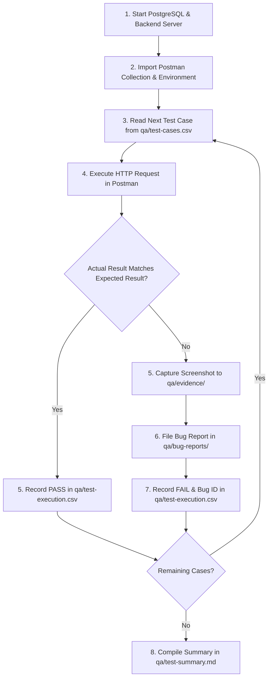

# FinTrack QA Test Plan

## 1. Test Objectives

The primary objectives of this test plan are to:
1. Verify the functional correctness, API contract compliance, input validation integrity, authentication security, and multi-tenant data isolation of the FinTrack application.
2. Establish a structured, reproducible, and verifiable QA process conforming to standard software testing practices (ISTQB / IEEE 829).
3. Validate backend business logic across positive paths, negative conditions, boundary limits, and edge cases before production readiness.
4. Provide complete traceability from test case design in [qa/test-cases.csv](file:///d:/Go/pet-projects/fin-track/qa/test-cases.csv) to execution logs in [qa/test-execution.csv](file:///d:/Go/pet-projects/fin-track/qa/test-execution.csv) and photographic evidence in [qa/evidence/](file:///d:/Go/pet-projects/fin-track/qa/evidence/).

---

## 2. Application Overview & Architecture

FinTrack is an isolated personal finance tracker with clear separation between backend services and client presentation:

- **Backend Architecture**: Go 1.25 service utilizing Gin Gonic (v1.10.0) organized in a clean 3-tier structure:
  $$\text{HTTP Handlers} \longrightarrow \text{Domain Services} \longrightarrow \text{Repositories (Raw SQL)}$$
- **Database Layer**: PostgreSQL 16 Alpine executed via Docker Compose, accessed using Go's standard library `database/sql` paired with `jackc/pgx/v5/stdlib`. All queries use explicit parameter placeholders (`$1, $2`) to eliminate SQL injection vulnerabilities. Connection pool tuned to 25 open connections.
- **Authentication & Security**: Stateless HMAC-SHA256 JWT tokens with 24-hour validity. Passwords hashed using `bcrypt`. Tenant data isolation is enforced directly at the SQL layer through explicit user scoping (`WHERE user_id = $X`).
- **Concurrent Ingestion**: CSV batch imports are processed via an in-process 4-worker goroutine pool over buffered channels, ensuring fast row validation and category mapping while committing all valid records in a single database transaction.
- **Monetary Representation**: Stored exclusively as strictly positive 64-bit integers (`int64` / `BIGINT`) in Vietnamese Đồng (VND), eliminating floating-point rounding errors (ADR-0002).

---

## 3. Scope of Testing

### 3.1. In-Scope Modules & Features (Phase 1 / Test Run `TR-001`)

Testing in Phase 1 focuses on the three core functional pillars of FinTrack across **46 designed test cases**:

#### 1. Authentication & Tenant Isolation (`AUTH-001` → `AUTH-019`, 19 Test Cases)
- **Account Registration (`POST /api/v1/auth/register`)**: Successful signup, optional display name handling, duplicate email conflict (`409 Conflict`), case-insensitive email collision, invalid email syntax (missing `@` or domain), and password length boundary testing (7, 8, 72, and 73 bytes).
- **Default Seeding**: Verification that new user registration automatically seeds 6 standard categories (Food & Dining, Transportation, Housing, Entertainment, Salary, Freelance).
- **User Login & Token Issuance (`POST /api/v1/auth/login`)**: Valid credential exchange for a 24-hour Bearer JWT, incorrect password rejection, and non-existent email rejection (`401 Unauthorized`).
- **Session & Profile Access (`GET /api/v1/auth/me`)**: Valid token profile retrieval, unauthenticated rejection (`missing authorization header`), non-Bearer scheme rejection, tampered signature rejection, and expired token rejection.
- **Tenant Profile Isolation**: Verification that User B's token retrieves only User B's profile without cross-contamination.

#### 2. Transaction Management (`TRANS-001` → `TRANS-020`, 20 Test Cases)
- **Creation (`POST /api/v1/transactions`)**: Positive creation of `EXPENSE` and `INCOME` transactions, uncategorized transactions (`category_id: null`), whole integer monetary handling, and large integer amount boundaries (`50,000,000,000` VND).
- **Validation Rules**: Rejection of zero and negative amounts (`400 Bad Request`), date formatting enforcement (`YYYY-MM-DD`), and required date validation.
- **Business Rule Enforcement**: Category-to-transaction type compatibility checks (rejecting Expense transactions assigned to Income categories and vice-versa) and category ownership checks (preventing assignment of categories owned by another user).
- **Retrieval & IDOR Security (`GET /api/v1/transactions/:id`)**: Owner retrieval of transaction details; IDOR protection verifying that User B attempting to view User A's transaction receives a masked `404 Not Found`.
- **Updates & Deletions (`PUT` & `DELETE /api/v1/transactions/:id`)**: Owner modification of transaction amounts/dates and owner deletion returning `204 No Content`.
- **Listing, Pagination & Filters (`GET /api/v1/transactions`)**: Default offset pagination (page 1, limit 20, descending date sorting), subsequent page retrieval, filtering by transaction type (`EXPENSE`/`INCOME`), date range filtering, and uncategorized filtering.

#### 3. CSV Batch Import (`CSV-001` → `CSV-007`, 7 Test Cases)
- **Multipart Upload (`POST /api/v1/transactions/import`)**: Ingestion of valid 5-row CSV statement files and database persistence verification.
- **Preflight Header Checks**: Rejection of non-standard localized column headers (`400 Bad Request`) and empty 0-byte files before worker pool initialization.
- **Row-Level Validation & Error Reporting**: Ingestion of mixed CSV files with partial failure reporting (line-numbered error descriptions for invalid date, invalid type, and negative amounts) while committing valid records atomically.
- **Automatic Category Fallbacks**: Verification that unknown category names or category type mismatches in CSV rows fall back gracefully to `category_id: null` (`Uncategorized`) per ADR-0008 rather than failing the import.

### 3.2. Out-of-Scope Activities

The following activities are excluded from Phase 1 manual API execution:
- **Budgets & Financial Analytics Manual API Testing**: While automated unit and integration tests exist in the Go codebase (`qa/log-terminal-result-tests.txt`), manual Postman execution for `/api/v1/budgets` and `/api/v1/analytics` is scheduled for Phase 2 (`TR-002`).
- **Performance & Load Testing**: Automated stress testing or high-concurrency benchmarks under artificial traffic.
- **Penetration & Dynamic Application Security Testing (DAST)**: Full-scale automated vulnerability scanning beyond manual authorization and IDOR boundary testing.
- **Automated Browser E2E Testing**: Client-side Cypress or Playwright test suites.
- **Cross-Browser & Mobile Matrix Testing**: Mobile viewport and cross-browser rendering audits.

---

## 4. Testing Methodology & Approaches

1. **Manual API Testing**: Structured execution of HTTP requests using Postman against local backend endpoints, validating request methods, query parameters, header envelopes, payload formatting, status codes, and JSON response bodies.
2. **Positive Testing (Happy Path)**: Ensuring standard user workflows operate exactly according to business requirements and database persistence expectations.
3. **Negative & Validation Testing**: Intentionally providing malformed data, omitted required fields, mismatched data types, and unauthorized tokens to verify that the application fails safely with standardized error contracts (`BAD_REQUEST`, `VALIDATION_ERROR`, `UNAUTHORIZED`, `CONFLICT`, `NOT_FOUND`).
4. **Boundary Value Analysis (BVA)**: Evaluating input thresholds, including password character limits (7, 8, 72, 73 bytes), monetary amounts (zero, large whole integers), pagination limits, and file size ceilings (5MB).
5. **Authorization & Tenant Isolation Testing**: Executing cross-tenant access attempts (using User B's token to read User A's transaction or categories) to confirm IDOR prevention and user scoping (`WHERE user_id = $X`).
6. **Data Integrity & Consistency Testing**: Inspecting database rows before and after imports, updates, and deletes to verify transaction atomicity and cascade behavior.

---

## 5. Test Environment & Prerequisites

| Component | Specification | Host / Port | Notes |
| :--- | :--- | :--- | :--- |
| **Backend Service** | Go 1.25 / Gin Gonic v1.10.0 | `http://localhost:8080` | Running via `go run ./cmd/server` |
| **Database** | PostgreSQL 16 Alpine | `localhost:5432` | Containerized via Docker Compose (`fintrack-postgres`) |
| **Frontend Web** | React 19 / Vite 8 | `http://localhost:5173` | Running via `pnpm run dev` in `web/` |
| **API Test Client** | Postman Desktop v11.x | Local client | Configured with `FinTrack Local` environment |
| **Test Case Tracker**| CSV File | `qa/test-cases.csv` | 12-column TestRail format |
| **Execution Logger**| CSV File | `qa/test-execution.csv` | Test run tracking and actual result log |

---

## 6. Test Data Requirements

All test data is synthetic and segregated into two isolated testing accounts:

- **Primary Test Account (User A)**:
  - Email: `tester_a@fintrack.local`
  - Password: `Password123!`
  - Display Name: `QA Tester A`
- **Secondary Test Account (User B - Multi-tenancy & IDOR testing)**:
  - Email: `tester_b@fintrack.local`
  - Password: `Password123!`
  - Display Name: `QA Tester B`
- **CSV Data Fixtures**: Pre-built files in [qa/test-data/](file:///d:/Go/pet-projects/fin-track/qa/test-data/):
  - `valid-transactions.csv` (5 valid rows)
  - `mixed-transactions.csv` (6 rows with mixed valid and invalid data)
  - `invalid-headers.csv` (localized column names)
  - `empty-file.csv` (0-byte file)
  - `unknown-category.csv` (unseeded category fallback test)
  - `category-type-mismatch.csv` (mismatched category type fallback test)

---

## 7. Entry & Exit Criteria

### 7.1. Entry Criteria
1. PostgreSQL container is healthy and all schema migrations (`000001` through `000003`) have been successfully applied.
2. Go backend service is running and `GET /health` responds with HTTP 200 `{"status":"ok"}`.
3. Postman Collection and Environment are imported and verified in Postman Desktop.
4. Test cases in `qa/test-cases.csv` are finalized with concrete preconditions, steps, and expected results.

### 7.2. Exit Criteria
1. 100% of planned test cases for the target run have been executed or their execution status is explicitly accounted for (`PASS`, `FAIL`, `BLOCKED`, `NOT RUN`).
2. Every failed test has a corresponding defect report filed under `qa/bug-reports/` with evidence attached in `qa/evidence/`.
3. Test execution metrics, pass rates, and known limitations are synthesized into [qa/test-summary.md](file:///d:/Go/pet-projects/fin-track/qa/test-summary.md) based directly on active execution records.

---

## 8. Test Execution Workflow

---

## 9. Defect Management & Classification

When unexpected behavior is observed:
1. **Differentiate Environment Issues from Application Bugs**:
   - Environment connection errors (`ECONNREFUSED`, PostgreSQL offline) are marked `BLOCKED` in execution notes.
   - Faulty logic, invalid HTTP status codes, validation leaks, or unhandled exceptions (`HTTP 500`) are flagged as application defects (`FAIL`).
2. **Defect Severity Tiers**:
   - **Critical**: Security breach (IDOR), cross-user data leak, unhandled server crash, or financial data loss.
   - **Major**: Core feature failure without workaround (unable to create valid transactions or authenticate).
   - **Medium**: Input validation omissions, misleading error messages, or unexpected status codes where a workaround exists.
   - **Minor**: Cosmetic formatting issues or minor wording inaccuracies.

---

## 10. Risks, Assumptions & Limitations

- **Database State Accumulation**: Creating transactions or importing CSV batches accumulates data in the local PostgreSQL instance. When re-running tests, duplicate email or unique category constraints must be respected by resetting the database or using unique identifiers.
- **Scope Distinction**: This plan covers manual API verification performed in Test Run `TR-001`. Automated unit and integration test execution is documented separately in `qa/log-terminal-result-tests.txt`.
- **Bearer Scheme Boundary**: Test case `AUTH-016` (non-Bearer authorization header format) was designed in `test-cases.csv` but omitted from manual execution in Run `TR-001` (though covered by Go backend unit tests); it is tracked as `NOT RUN`.